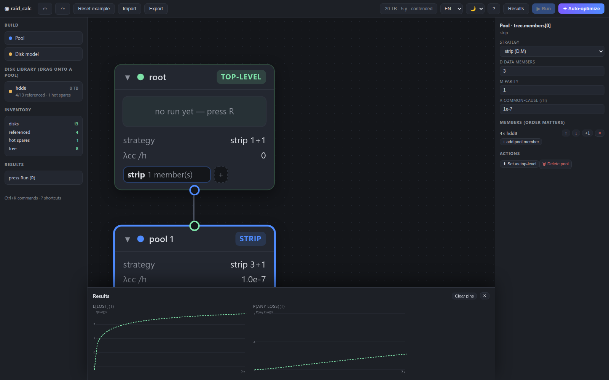

[English](README.md) | **简体中文**

<p align="center">
  
</p>

<h1 align="center">raid_calc</h1>

<p align="center"><strong>不只判断 RAID 是否“安全”，而是算出存储池随时间推移的预期数据损失。</strong></p>

<p align="center">一个单文件、离线的浏览器计算器：把磁盘组合成任意深度的嵌套存储池，用精确的 CTMC 数值方法计算数据损失随时间的数学期望。</p>

<p align="center">
  <a href="raid-calc.html">应用文件</a> · <a href="LICENSE">MIT 许可证</a> · <a href="CONTRIBUTING.md">参与贡献</a>
</p>



*编辑器用树状结构搭建存储池；结果抽屉绘制顶层的 `E[lost](t)` 与 `P(any loss)(t)` 曲线。*

## 快速开始

克隆仓库后，用现代浏览器打开 [`raid-calc.html`](raid-calc.html) 即可。无需服务器、无需联网、无需构建，完全离线运行。

```bash
git clone https://github.com/ZisIsNotZis/raid_calc.git
cd raid_calc
open raid-calc.html      # macOS；Linux 用 xdg-open raid-calc.html，或直接双击文件
```

仓库中的 HTML 由 [`src/`](src/) 生成，因此克隆后可以直接从磁盘打开。修改源码后重新构建：

```bash
npm install
npm run build
```

## 当前能力

- **组合真实的存储层级。** `concat`、`strip(D,M)`、`split(N,M)`、`strip-split(N,M)` 可以任意嵌套；每个池对上层暴露为一个逻辑磁盘。
- **给出期望曲线，而不是一个 MTTF 数字。** 用一致化（uniformization）求解连续时间马尔可夫链（CTMC），精度到 1e-12，输出整个时间范围内的 `E[lost bytes](t)` 与 `P(any loss)(t)`。蒙特卡洛只用于交叉验证，不作为主结果。
- **建模真正主导结果的故障。** 计算重建时间与工作负载的带宽争用，计入重建读取的 URE 风险、共因故障、按磁盘型号共享的热备库存，以及运维和采购等待。
- **两种损失口径。** *严格* 口径把任何损坏都算作文件丢失；*部分* 口径只计算超出校验能力的分块，描述“降级但仍可用”的数据。
- **可视化编辑。** 拖动池卡片改变父子关系，从磁盘库拖入磁盘，重新连线，折叠子树，查看每个池的损失曲线。内置撤销/重做、命令面板（`Ctrl+K`）、快捷键（`?`）、JSON 导入导出、中英文切换和明暗主题。
- **搜索设计方案。** 自动优化器在容量、单盘带宽和备件库存约束下执行贪心加局部搜索，把胜出的配置直接画回画布，并列出前三名。
- **保持可携带。** 一个 HTML 文件，一份 JSON 配置。没有后端、没有遥测、没有运行时依赖。

## 架构

计算核心是纯函数，UI 是唯一有副作用的层。构建时把两者内联进单文件产物。

```text
src/core/      纯模型与 CTMC 引擎：config、strategies、machine、ctmc、
               evaluate、Monte Carlo、optimizer、errors
src/ui/        编辑器、画布、属性面板、图表、结果、i18n、命令
scripts/       build.mjs、Playwright 冒烟测试、求解器基准
demo/          打印曲线的小型 CLI 示例
tests/         vitest：闭式校验、组合恒等式、MC 一致性、UI 逻辑
docs/design/   模型、优化器、UI 与架构决策
index.html     开发外壳；build.mjs 将 src/ 内联为 raid-calc.html
```

同一份配置 JSON 是画布、引擎、优化器和保存文件的唯一事实来源。引擎读取配置并返回曲线及每个节点的预览；UI 和优化器只负责生成配置。

完整设计见：[模型](docs/design/raid-calc.md) · [优化器](docs/design/optimizer.md) · [UI](docs/design/ui.md) · [架构](docs/design/architecture.md)。

## 开发

需要 Node.js 和 npm。

```bash
npm test             # vitest：闭式校验、组合恒等式、MC 一致性、UI 逻辑
npm run demo         # CLI：评估两个配置并打印曲线采样
npm run build        # esbuild -> raid-calc.html（提交的产物）
npm run smoke        # Playwright：用真实指针手势驱动构建后的应用
node scripts/bench-solver.mjs   # 求解器速度证据
```

`src/core` 不接触 DOM 和全局状态。数值改动必须让闭式测试保持通过；UI 行为改动需要在 `scripts/ux-smoke.mjs` 中补上 Playwright 检查。

## 参与贡献

先读 [CONTRIBUTING.md](CONTRIBUTING.md)。简而言之：说明问题与验收标准，保持 `npm test` 通过，修改源码后重新构建并提交产物，为 UI 或数值改动附上证据。

## 路线图

### 已实现（v1）

- [x] 精确 CTMC 引擎：一致化求解、`lossCurves` 与 `anyLossCurve`；保留 RK4 作为参考方法。
- [x] `concat` / `strip` / `split` / `strip-split` 嵌套组合与精确状态记账。
- [x] 重建带宽争用、URE 风险、共因故障、共享备件簇与维修等待。
- [x] 严格与部分两种损失口径。
- [x] 直接操作画布、每池预览、结果抽屉、撤销/重做、命令面板、国际化与主题。
- [x] 带可行性约束的确定性自动优化器与前三名输出。
- [x] 蒙特卡洛交叉验证、vitest 测试与真实浏览器冒烟证据。
- [x] 单文件离线产物与 v1 设计文档。

### 计划中

暂无排期：v1 已收尾。若项目继续推进，自然的下一步是 v1 明确排除的内容——IOPS/延迟与排队、scrub 与潜在错误累积、老化曲线、操作失误——以及更大的状态空间，用文件大小分布替代“平均文件大小”近似。

长期形态是像电子表格一样可信的计算器：搭出任何实际可运维的层级，立刻看到预期损失曲线，并让优化器解释它所做的取舍。能精确的地方保持精确，每一处近似都在 UI 和设计文档里标明。

已知限制：超大机器（约 10 万状态以上）在多年时间范围上仍然昂贵。它们会以 `BuildError` 快速失败而不是挂起；优化器对每个候选限制 20,000 个状态，并报告跳过了哪些候选。

## 许可证

[MIT](LICENSE)
